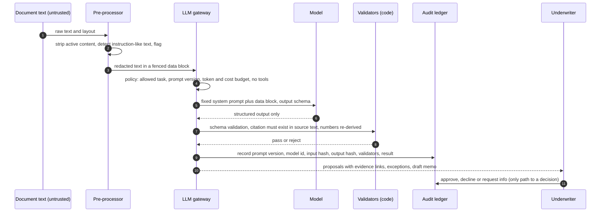

# Agentic layer design (B-202)

Scope: the AI components that extract facts, flag exceptions and draft the credit memo. Labels: [V] verified, [I] inferred, [A] assumed.
Hard constraint: AI never makes or communicates a credit decision (D-001). The agent layer can only create proposals.

## 1. Flow with defenses



## 2. LLM gateway (single egress)
Every model call goes through one module. It enforces:
- **Task allowlist and fixed prompts.** Named tasks (extract_facts, draft_memo_section, classify_document). Prompts are versioned files; the prompt version, model id, parameters and the hash of inputs and outputs are written to the audit ledger.
- **No tools by default.** Extraction and drafting calls have no tool or function-calling access. If a later task needs a tool, it is read-only, scoped to the current case, and added through a decision record.
- **Structured output only.** Output must validate against a schema (types, enums, required citation). Free text never flows into rules, SQL, shell, HTML or URLs (improper output handling).
- **Budgets.** Per-tenant, per-case and per-day token and cost limits, request size limits, timeouts, and a circuit breaker (unbounded consumption).
- **Provider allowlist** and per-provider data-handling settings; no use of tenant data for provider training (to verify per provider, D-015).
- **PII redaction.** Taxpayer IDs, account and routing numbers, dates of birth and similar are replaced with stable tokens before the call and restored after, using a per-tenant token vault; the model never needs the raw identifier to extract a value's position or sanity-check its format. Fields that must be read by the model (for example, income amounts) are not treated as PII tokens. [I] Redaction quality is an evaluated component with its own test set.
- **No raw sensitive text in logs**: logs carry hashes, ids and sizes.

## 3. Prompt-injection defenses for uploaded documents
Documents are adversarial by default (a borrower, or someone upstream, can embed instructions). Defense in depth; no single layer is a boundary:
1. **Architecture first:** document-reading calls have no tools and no authority; output is schema-checked; only proposals are produced. A successful injection can at worst produce a wrong proposal, which later layers must catch.
2. **Data fencing:** document text is passed in a delimited data block, with a fixed instruction that its content is data. This lowers, but does not remove, susceptibility.
3. **Tripwire:** pattern scan for instruction-like text (already implemented as a weak first layer in `src/pipeline.ts`); hits create a high-severity exception for human review and never change a decision.
4. **Source verification:** every extracted value must appear in the cited page text (string/number match after normalization); values without a verifiable citation are rejected.
5. **Re-derivation:** totals, ratios and cross-document values are recomputed by code; mismatch becomes an exception.
6. **Human review** of exceptions and of all decisions.
7. **Adversarial test set** (fixtures 04 and more): injected instructions, hidden text, conflicting figures designed to push the memo toward approval; run in CI on every change to prompts or gateway.

## 4. OWASP Top 10 for LLM Applications (2025) mapping [V list, S-23; controls are our design]
| ID | Risk | Our control | Test |
|---|---|---|---|
| LLM01 | Prompt Injection | Sections 1 and 3: no tools, schema output, citation verification, tripwire, human gate | Injection fixtures must not change checklist outcomes or create decisions |
| LLM02 | Sensitive Information Disclosure | Redaction, tenant-scoped retrieval only (no cross-tenant context), no PII in logs, output filtering for tokens | Cross-tenant canary strings never appear in outputs |
| LLM03 | Supply Chain | Pinned dependencies and lockfile, SBOM, provider allowlist, review of third-party skills and scripts before use (see .agents/skills/THIRD_PARTY.md) | CI dependency audit |
| LLM04 | Data and Model Poisoning | We do not train or fine-tune on tenant data in the MVP; prompt and rule changes go through review and the evaluation set | Eval regression before merge |
| LLM05 | Improper Output Handling | Schema validation, escape on render, never execute or interpolate model output | Fuzz outputs through renderers and rule inputs |
| LLM06 | Excessive Agency | No tools, no write path except proposals, no outbound messages; decisions need a human | Tests that the agent role cannot call decision or servicing code |
| LLM07 | System Prompt Leakage | Prompts hold no secrets or policy that must stay hidden; secrets live in the platform store | Prompt-extraction attempts in adversarial set |
| LLM08 | Vector and Embedding Weaknesses | No vector store or retrieval in the MVP; if added, per-tenant indexes and the same RLS rules | Gate: no retrieval without a decision record |
| LLM09 | Misinformation | Citations required; numbers re-derived; memo statements must map to accepted facts; "unknown" is an allowed output | Faithfulness metric (docs/MEASUREMENT_PLAN.md) |
| LLM10 | Unbounded Consumption | Budgets, size limits, timeouts, concurrency caps, circuit breaker | Load and oversized-document tests |

## 5. Human approval gates
| Gate | Who | Required before |
|---|---|---|
| G-A Fact acceptance | Deterministic validators, or underwriter confirmation | A fact feeds rules, calculators or the memo |
| G-B Exception disposition | Underwriter | Case leaves needs_review |
| G-C Memo adoption | Underwriter edits and adopts | Memo is stored as the credit memorandum |
| G-D Credit decision | Authorized underwriter role | Any approve, decline or request-more-info; any servicing event |
| G-E Rule or prompt change | Builder review recorded in the repo | Merge of rule packs, prompts, gateway or tenancy code |

## 6. Immutable audit trail
Append-only ledger (database trigger denies UPDATE and DELETE; hash chain per tenant). Event kinds:
```ts
type AuditEvent = {
  id: string; tenantId: string; seq: number; prevHash: string; hash: string; at: string;
  actor: { kind: "user" | "agent" | "system"; id: string; role?: string };
  action:
    | "document.received" | "document.processed"
    | "fact.proposed" | "fact.accepted" | "fact.rejected" | "fact.conflict_flagged"
    | "rule.evaluated" | "calculation.run" | "exception.raised" | "exception.disposed"
    | "memo.drafted" | "memo.adopted"
    | "llm.call" | "decision.recorded" | "servicing.event_emitted" | "access.denied";
  subject: { caseId?: string; documentId?: string; factId?: string };
  inputsRef: string[];            // ids/hashes, not raw text
  rule?: { pack: string; version: string; sopSection: string };
  llm?: { provider: string; model: string; promptVersion: string; inputHash: string; outputHash: string };
  result: "ok" | "rejected" | "error";
};
```
Every agent action, data source and rule fired is an event; a lender can reconstruct "what was seen, by what, under which rule version".

## 7. Versioning and change control
Rule packs are versioned by SOP version and effective date; prompts are versioned files; model ids are pinned. A change to any of them re-runs the evaluation set and must pass before merge (G-E). The decision record stores the versions used, so a past decision can be replayed.

## 8. Limits and open items
- Redaction and injection defenses are not proven. They are measured with the adversarial set, and results go in the evaluation report (B-308).
- Provider terms (retention, training, region, subprocessors, security reports) are unverified (D-015).
- Whether a lender will accept AI-prepared analysis is a legal/compliance question (LEGAL_REVIEW 1, 7, 13).

## 9. Implemented so far (loop 7) and what is not
Built and tested (workspace/app/src/llm, extraction, ingest): gateway as single egress; task and field allowlists; per-case call and token budgets and an input size cap; redaction of SSN, EIN, account and routing numbers, emails and phone numbers with token restore; timeout; strict output schema; citation verification against the original text (page, passage and value must match); deterministic validators (bank arithmetic, balance sheet, stale statement, income reconciliation); injection tripwire that blocks auto-acceptance for the flagged document; audit events with hashes and prompt/model ids.
Fact acceptance semantics (D-019): "accepted" means the value was faithfully extracted, cited, internally consistent and from an unflagged document. It does NOT mean the value is true. A borrower can print any number. Verifying truth (IRS transcripts, bank data, lender policy) is a separate, later step and stays with the underwriter.
Not built: a real model provider and its data terms (D-015); OCR or PDF text extraction (PDF and image uploads are stored and routed to manual review); redaction of personal names and addresses; per-tenant persistent token vault; rate limiting and authentication on the upload route; memo drafting; exception disposition by an underwriter.
