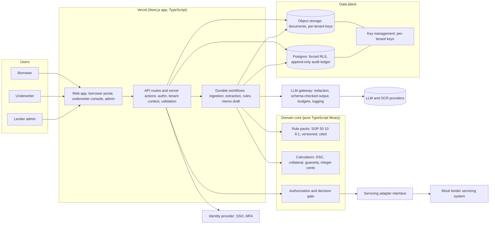
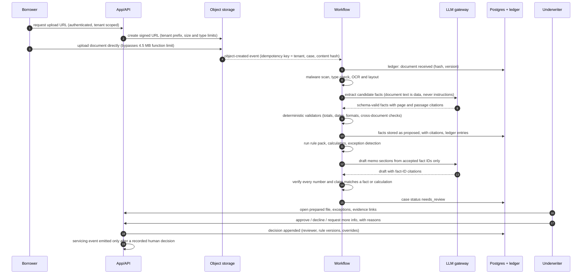
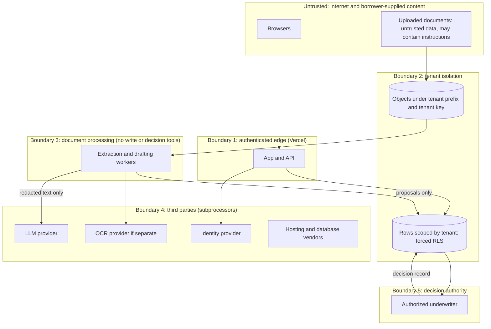
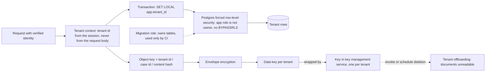
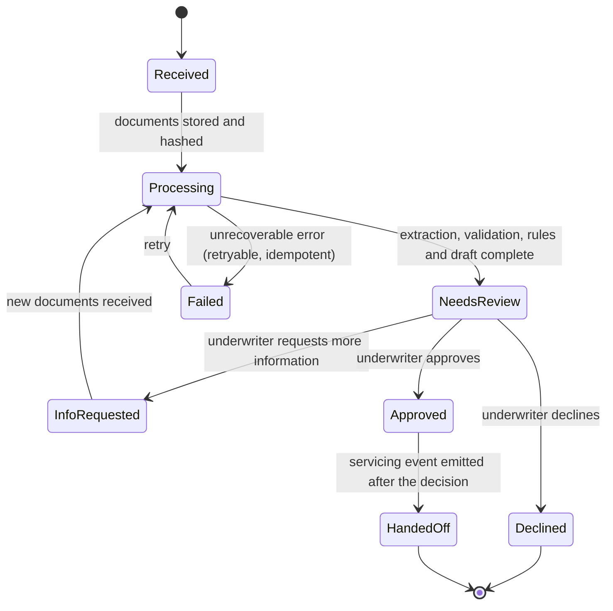

# Reference architecture (B-201)

Status: provisional design for the MVP and a first lender pilot. Labels: [V] verified in a cited source, [I] inferred, [A] assumed. Nothing is deployed.
Principles: AI extracts, reconciles and drafts; tested code computes and applies rules; a human underwriter decides (D-001). Boring, managed, low-cost. Every fact has a citation. Every action is in an append-only audit ledger.

## 1. Components

- **App on Vercel (TypeScript, Next.js).** Borrower portal, underwriter console, admin. API routes and server actions are thin: authenticate, resolve the tenant, validate input (schema validation at every boundary), call the domain core.
- **Domain core (pure TypeScript library, already started in `workspace/app/src`).** Rule packs, calculators, reconciliation, case state machine, decision gate. No I/O; fully unit-testable.
- **Durable workflows.** Ingestion, extraction, rules and memo drafting run as retryable steps. Vercel Workflows (durable steps that resume after crashes or deployments) and Queues (at-least-once delivery, so every step must be idempotent) are documented but Queues is reported as beta [V, S-26]. Functions alone are not enough: Pro functions can run up to 800 seconds (1800 in beta) [V, S-24], and uploads through a function are capped at 4.5 MB [V, S-24].
- **Postgres** with forced row-level security and an append-only audit ledger (section 4). Vendor not chosen (D-014).
- **Object storage** for documents, with per-tenant keys (section 4). Vendor not chosen (D-013).
- **LLM gateway** (section 3 and docs/AGENTIC_LAYER.md): the only code that talks to a model provider.
- **Identity provider** for lender staff with SSO and MFA (D-011 open).
- **Servicing adapter interface** with a mock implementation; webhooks and events emitted only after a recorded human decision.

## 2. Data flow

Design points: direct-to-storage upload avoids the 4.5 MB function body limit [V, S-24]; each step is idempotent by key (tenant, case, content hash); facts are stored as proposed, with citations; acceptance needs deterministic validation or a human confirmation (confidence alone never accepts a fact, AGENTS rule 8).

## 3. Trust boundaries

1. Internet to the authenticated edge. 2. Tenant isolation (data plane). 3. Document processing: workers that read untrusted documents have no tools that write canonical data, record decisions, send messages or call arbitrary URLs; they emit proposals only. 4. Third parties are subprocessors and appear in the vendor list a lender will review. 5. Decision authority: only an authorized underwriter's recorded action advances a case to a decision.

## 4. Tenant isolation and encryption

- **Row-level security [V, S-25].** Postgres docs: with RLS enabled and no policy, all rows are denied; table owners normally bypass RLS unless the table is set to FORCE ROW LEVEL SECURITY; superusers and roles with BYPASSRLS always bypass. Therefore: the application role is not the table owner, has no BYPASSRLS, and tables are FORCEd; a separate migration role owns tables and is used only by CI. Tenant id comes from the verified session and is set per transaction (`SET LOCAL`), which is safe with transaction-mode connection pooling [I].
- **Tests that fail if weakened** (backlog B-402): a test connects as the app role and proves cross-tenant reads return nothing, paired with a positive control proving the same query succeeds for the owning tenant (a denial test needs a control or it can pass because nothing ran).
- **Per-tenant encryption.** Envelope encryption: a data key per tenant wrapped by a key in a key-management service; deleting or revoking the tenant key makes the tenant's documents unreadable (offboarding). Which service is open (D-013). [A] Using AWS KMS and S3 from a Vercel app requires cross-cloud authentication; whether Vercel's OIDC federation covers this is not verified (B-113).
- **Application-level field encryption** for the most sensitive fields (taxpayer IDs, account numbers), so a database dump alone is not enough [I].
- **Secrets** only in the hosting platform's secret store, never in the repository; least-privilege roles per component.

## 5. Case lifecycle

"Approved" and "Declined" are reachable only through a decision record by an authorized underwriter; the processing pipeline can only reach NeedsReview or Failed.

## 6. Audit ledger (summary; full event list in docs/AGENTIC_LAYER.md)
Append-only table per tenant; a trigger rejects UPDATE and DELETE; each event stores the hash of the previous event so tampering is detectable [I, design]; periodic anchoring of the chain head to an external write-once store is a later hardening step. The ledger holds references and hashes, not raw document text.

## 7. Open decisions and risks
| Decision | Options | Status |
|---|---|---|
| D-011 Authentication | Managed identity provider with SAML SSO and MFA; criteria: SSO for lender staff, organization/tenant model, audit logs, data residency | Open (B-117). Prices not verified |
| D-013 Document storage and tenant keys | S3 + KMS; Vercel Blob; other | Open. Per-tenant key control on Vercel Blob not verified |
| D-014 Database | Postgres via Vercel marketplace partner; AWS RDS | Open. Need: forced RLS, point-in-time recovery, region pinning |
| D-015 LLM/OCR provider | One or more providers behind the gateway | Open. Requirements: no training on our data, retention terms, region, SOC report; verify each |
| D-016 Background execution | Vercel Workflows (durable) vs Queues | Leaning Workflows [I, S-26]; confirm limits and cost |

Cost report: provisioned monthly cloud cost today is $0 (nothing deployed, local development only). Production-like spend is not estimated here because plan prices were not verified; B-113 will fill a cost model from vendor price pages. Known cost drivers: function active CPU and memory [V, rates in S-7], database, object storage and key operations, LLM and OCR per document, logging.

Top risks: cross-cloud key and identity wiring; beta status of Queues and large-duration functions; per-tenant key support on the chosen storage; subprocessor count in lender vendor review.
